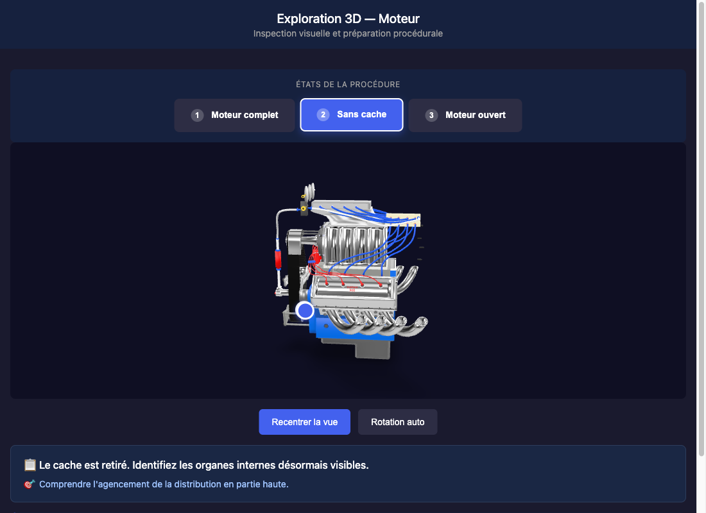

# Engine exploration — 3D procedure walkthrough

**A step-by-step 3D walkthrough of an engine disassembly, in the browser.** Each step removes a part of the engine and comes with an instruction, a learning objective and hotspots on the components that matter at that stage — so trainees arrive at the workshop already knowing what they'll see.

**[▶ Live demo](https://fredbourouliou.github.io/exploration-3d-moteur/)** · UI in French

<p align="center">
  
</p>

## What it does

- **3 procedure steps**, one GLB each: full engine → cover removed → timing side open.
- **Per-step instruction and objective** ("The cover is removed. Identify the internal parts now visible.").
- **Hotspots generated per step** from a single config object: position, normal, title, short technical note.
- Orbit, zoom, re-center, auto-rotate; **AR** on phones (WebXR, Scene Viewer, Quick Look) and the Meta Quest browser.

It is a visualisation aid, not a mechanical simulation: nothing to grab or unscrew, by design.

## How it's built

- One `index.html` with [`<model-viewer>`](https://modelviewer.dev/) and vanilla JS — no framework, no build step.
- Steps and hotspots live in one `ENGINE_STATES` object, so adding a step means one GLB and one entry.
- [`scripts/export_states.py`](scripts/export_states.py) exports every step from the Blender file in one headless run.

```bash
python3 -m http.server 8000   # then open http://localhost:8000
```

## Related

[hemi-engine-ar](https://github.com/FredBourouliou/hemi-engine-ar) — the same engine as a guided inspection module with 5 phases and AR placement.

## License

Code under the [MIT License](LICENSE).
